# Workflows

Sequence diagrams for the ✅ capabilities in [`capabilities.md`](./capabilities.md).
Each one pairs two levels: **"What you experience"** — just the user and
cntxt as a black box, the goal it serves — and **"Under the hood"** — traced
directly from the current code (`extension/entrypoints/background.ts`,
`utils/attach.ts`, `utils/restoreMachine.ts`, `utils/windowSyncMachine.ts`).
The "under the hood" diagrams are accurate to what runs today — update them
alongside the code, not after the fact.

For ❌ capabilities there's no real flow to trace yet, so those sections are
short prose **scenarios** instead of diagrams: a sketch of the intended user
experience per the `Workspace Dashboard v2` design, not a spec.

## Capture & restore

### Opening a window for the first time (icon click)

The path that creates a Project from whatever tabs are already open, the
first time you click the extension icon in a window that has no binding yet.

**What you experience:**

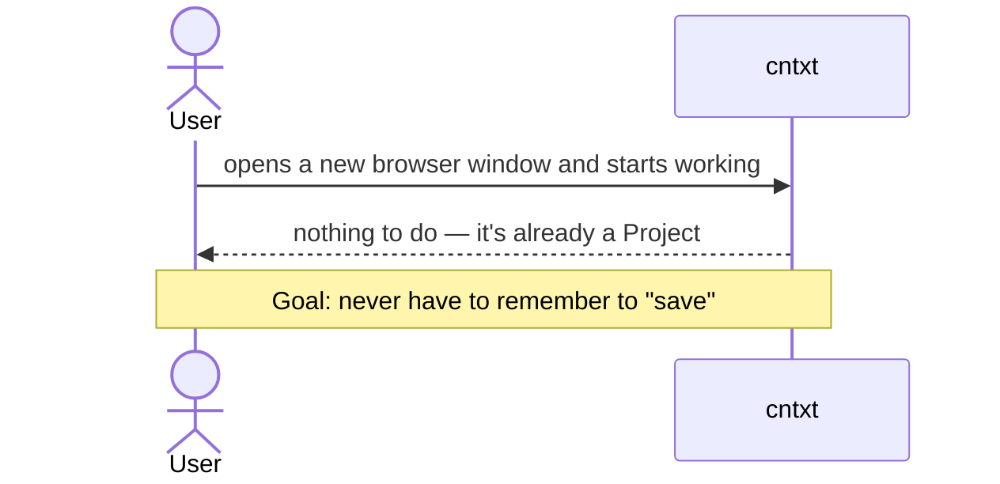

**Under the hood:**

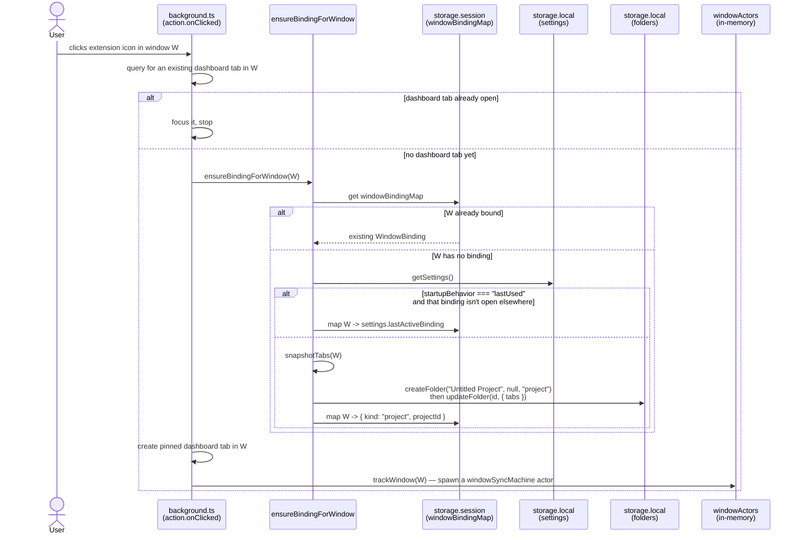

### Live tab sync

Every tab change in a tracked window re-snapshots that window's tabs into
whatever it's bound to — this is what makes "saving" invisible.

**What you experience:**

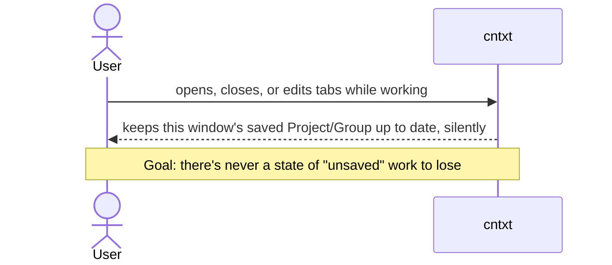

**Under the hood:**

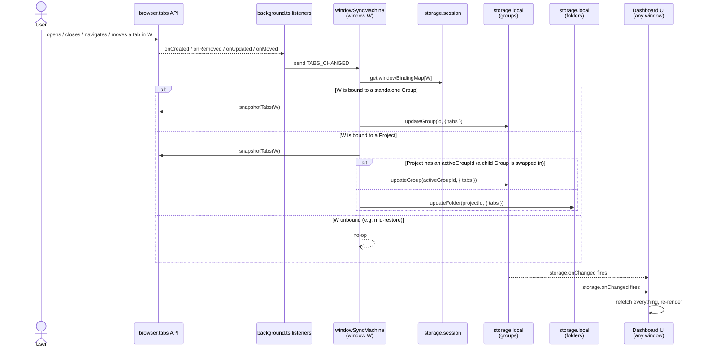

### Service worker rehydration

MV3 background scripts restart often (idle unload, browser restart). The
in-memory actor registry doesn't survive that, so it's rebuilt from
persisted session state on every wake — this is called out in `CLAUDE.md`
as load-bearing, not incidental.

**Why it matters to you:** purely internal reliability plumbing — nothing to
diagram from the user's side, since the point is that you never notice it
happened. A tab you were tracking never silently stops syncing just because
the browser put the extension to sleep.

**Under the hood:**

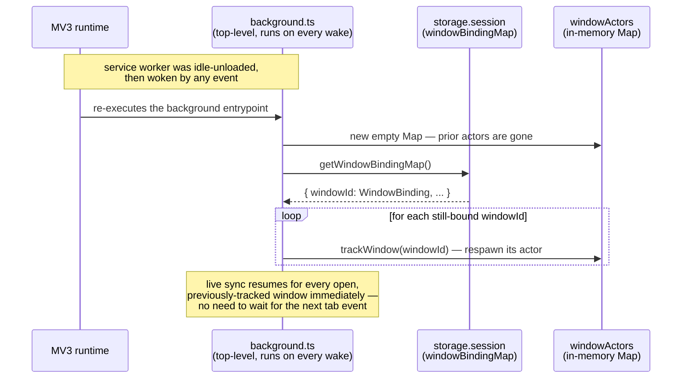

### Startup: resume last-used Project or Group

Runs once per browser launch, for every already-open window, when
`settings.startupBehavior === "lastUsed"`.

**What you experience:**

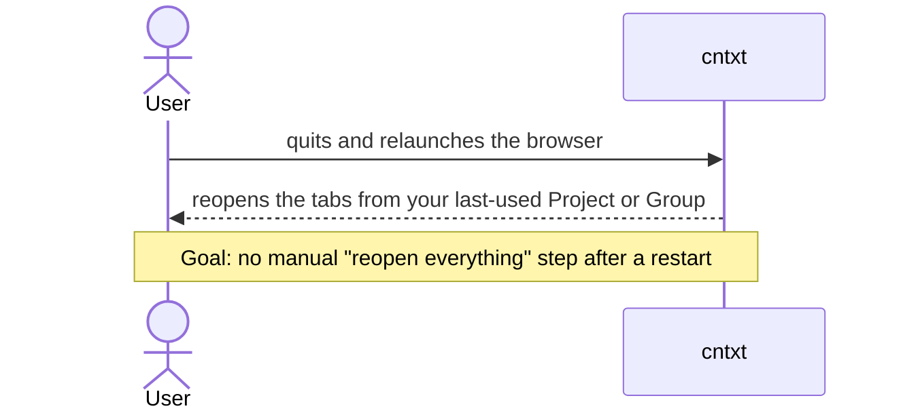

**Under the hood:**

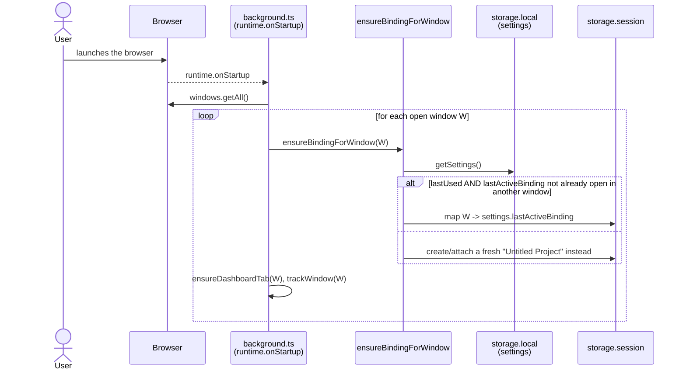

### Close all tabs

The simple half of `restoreMachine`: no binding switch, so the window
stays bound to its current Project or Group throughout.

**What you experience:**

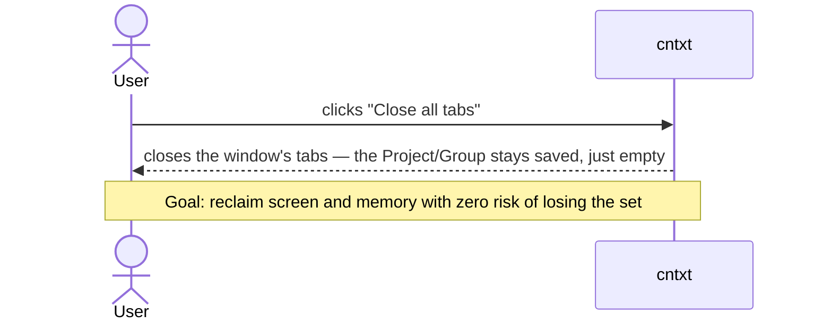

**Under the hood:**

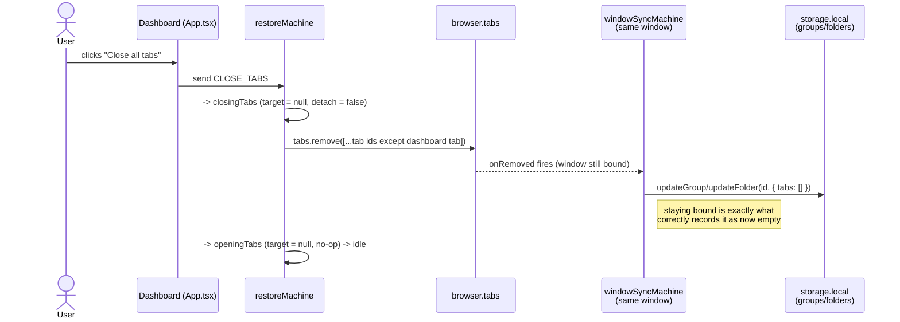

### Restore / switch Project or Group

The subtle one: restoring into the _current_ window is a close-then-open,
and the outgoing binding must be detached **before** its tabs close — or
live-sync would zero out the thing being left behind instead of the one
being closed. Covered by `utils/restoreMachine.test.ts`. (This is about
changing a window's `WindowBinding` — restoring to a different Project or a
different standalone Group. Swapping which child Group is active _within_ a
Project's already-open window is a separate concept, `groupSwapMachine`,
which never touches the binding — see `group-activation-semantics.md`.)

**What you experience:**

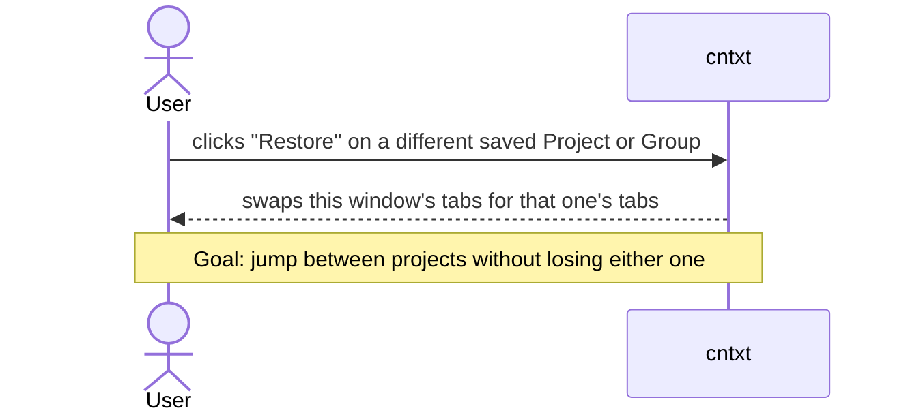

**Under the hood:**

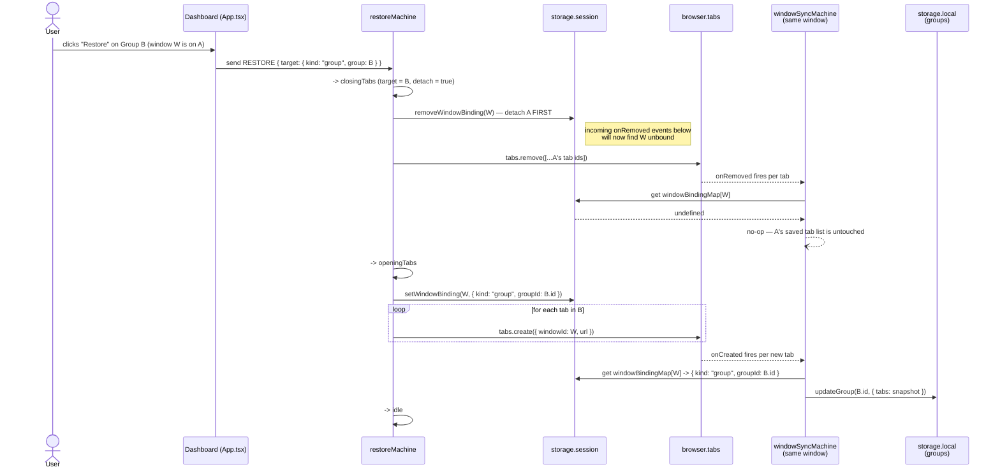

Restoring a Project instead of a standalone Group follows the identical
shape, just opening whichever tabs `resolveProjectLiveTarget` resolves to
(the Project's own `tabs`, or its `activeGroupId` child's, if one is set) —
see `utils/projectLiveTabs.ts`.

### Rename / delete a Group

Plain CRUD, no diagram needed: the dashboard calls `updateGroup`/
`deleteGroup` directly, then re-fetches. No window-mutating side effects,
no machine involved.

## Organization

**Shipped, differently than the scenario originally sketched here:** the
original idea was dragging a tab into a named, colored group _within one
workspace's flat tab list_ (`Workspace.sections: {id,name,color,tabs}[]`).
What actually shipped instead is structural, not a tab grouping: Area →
Project → Section (a `kind` on the shared `Folder` type, see `CLAUDE.md`),
where Section holds Resources (links/notes), not tabs, and a Group nests
under a Project rather than a tab nesting under a section. Tab-level
grouping within a single Group/Project's own tab list remains unbuilt — see
`capabilities.md`'s Organization table for the current, corrected status of
each piece.

## Navigation & search

**Mostly shipped** (see `capabilities.md`): a persistent sidebar rail
(Areas → Projects → Sections/Groups, collapsible) and a `⌘K` command palette
both exist in `App.tsx` today. No "under the hood" trace for either here yet
— add one the next time this file is touched alongside that code, per this
page's own stated contract. Display preferences (show domains, grid vs.
list, search scope) remain unbuilt.

## Live-open-tabs panel — not implemented

**Scenario, and why it doesn't fit as designed:** a right-hand panel lists
tabs open in the browser that aren't in any Project/Group yet, each with its
own "Save" button. That presumes some windows aren't auto-attached — the
opposite of "every window is a workspace." Building this means first
deciding whether some windows should opt out of live-sync, not just adding
UI.

## Sync (Phase 2, shipped) & team (Phase 3, not implemented)

Cross-device sync is built — see `architecture-sync.md`'s own diagrams
(Push, Pull + conflict resolution) for the "under the hood" traces, not
duplicated here. In short: you save a Project/Group on your laptop, open the
browser on a different machine signed into the same account, and it's
already there — `updated_at` last-write-wins, no merge UI.

**Team scenario, still unbuilt:** in Phase 3, a teammate opens the same
shared Project and sees your tab list update in real time via Supabase
Realtime.
